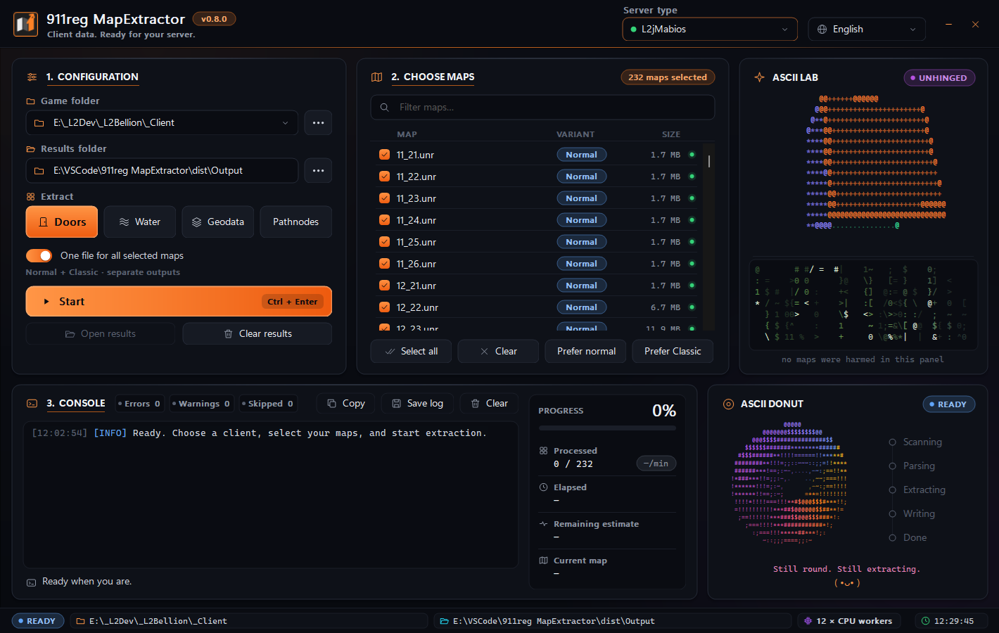

# 911reg MapExtractor

Turns Lineage II client maps into server-ready data. One Windows program, no install.

[Watch geodata generation](docs/demo.gif)

## Features

- **Doors**: XML for L2JServer, aCis, L2Scripts and L2jMabios, or L2OFF `doordata` entries
- **Water**: water zones as XML per server, or L2OFF `areadata` entries
- **Geodata**: L2J `.l2j` (default) or L2OFF `_conv.dat`, built from the client's own collision
- **Pathnodes**: `.pn` files for servers that use them
- Pick exactly which maps to process; Normal and Classic maps both supported
- One combined file or one file per map
- Uses every CPU core, with pause and resume
- Close it any time: unfinished output is cleaned up on the next run
- Live console, progress and time estimates (and a spinning ASCII donut)
- English, Greek, Spanish, Brazilian Portuguese, Albanian, Romanian and German
- Reads your client only; game and server files are never changed

## Use

1. Download the latest release and run `MapExtractor.exe`. Keep the `Languages` and `profiles` folders next to it.
2. Choose your game folder.
3. Pick a task and your server type, check the maps you want, then click **Start**.
4. Copy the results from the `Output` folder. Each result folder has a short README that says where the files go.

Test new geodata in game before using it on a live server.

Building from source and technical details: [DEVELOPERS.md](DEVELOPERS.md).
